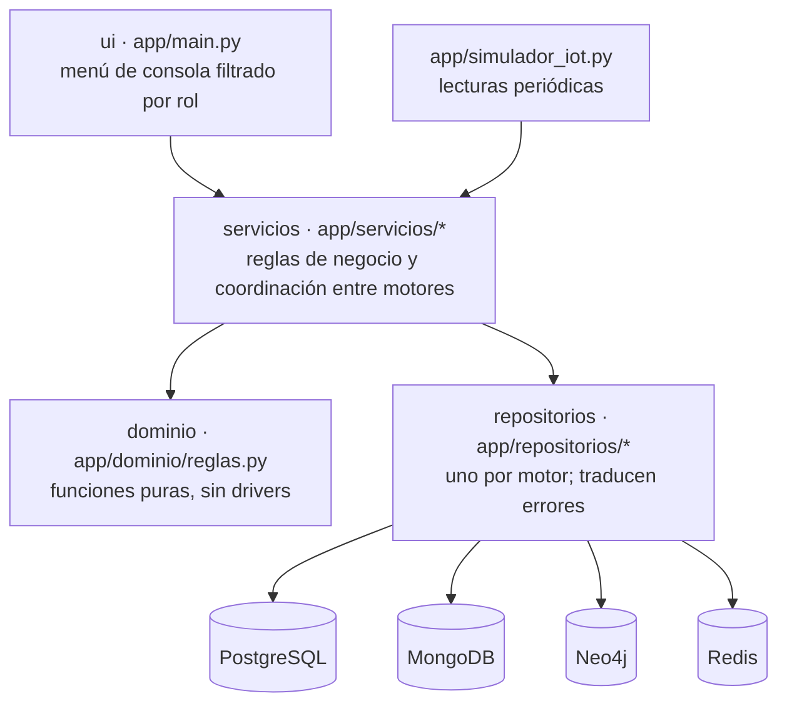
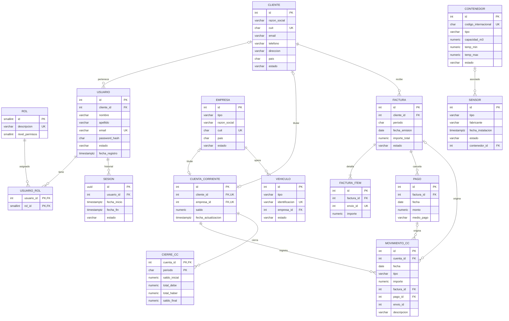
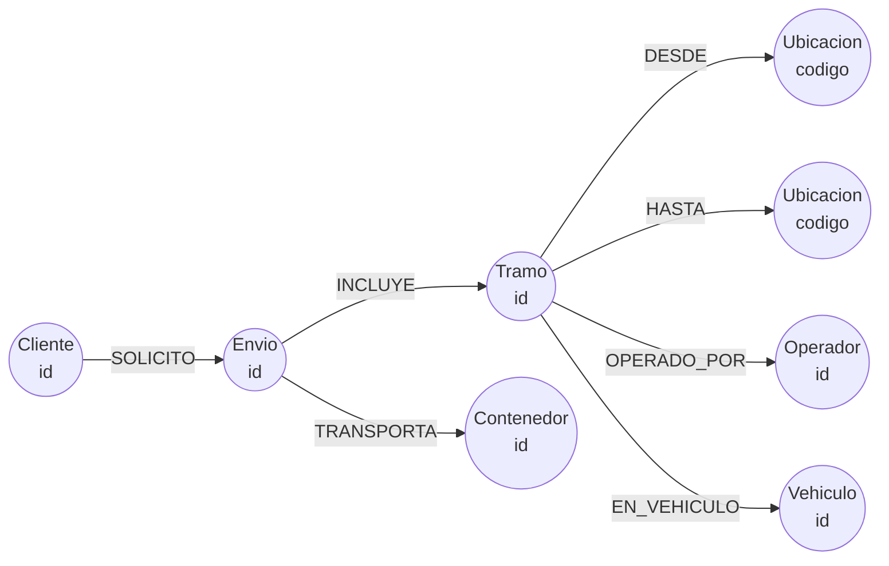

# Informe técnico — Persistencia Políglota

**Ingeniería de Datos II · UADE · Plataforma de logística internacional con monitoreo IoT**

Aplicación de consola en Python 3.11 que gestiona clientes, operadores, envíos multimodales, sensores IoT,
trazabilidad, mensajería, facturación y análisis predictivo sobre cuatro motores de base de datos:
PostgreSQL 16, MongoDB 7, Neo4j 5 y Redis 7.

Contenido:

1. [Informe técnico: arquitectura y ejecución](#1-informe-técnico-arquitectura-y-ejecución)
2. [Justificación de la persistencia políglota](#2-justificación-de-la-persistencia-políglota)
3. [Modelos físicos](#3-modelos-físicos)
4. [Consistencia y teorema CAP](#4-consistencia-y-teorema-cap)
5. [Desafío de complejidad adicional](#5-desafío-de-complejidad-adicional)
6. [Decisiones, supuestos y atributos agregados](#6-decisiones-supuestos-y-atributos-agregados)
7. [Mejoras propuestas para producción](#7-mejoras-propuestas-para-producción)
8. [Herramientas fuera del temario](#8-herramientas-fuera-del-temario)
9. [Anexo: requisitos, opciones de menú y servicios](#9-anexo-requisitos-opciones-de-menú-y-servicios)

---

## 1. Informe técnico: arquitectura y ejecución

### 1.1 Arquitectura en capas



| Capa | Módulos | Responsabilidad |
|---|---|---|
| Interfaz | `main.py`, `simulador_iot.py`, `datos_prueba.py` | Pedir datos, mostrar resultados, filtrar el menú por nivel de rol. No contiene reglas de negocio. |
| Servicios | `auth`, `operativa`, `monitoreo`, `trazabilidad`, `mensajeria`, `comercial`, `reportes`, `prediccion`, `sincronizacion` | Validan permisos y alcance, aplican reglas, coordinan transacciones y compensaciones entre motores, registran logs. |
| Dominio | `dominio/reglas.py` | Reglas puras: importe con margen, evaluación de lecturas, períodos, pagos, tramos, predicción. Se testea sin bases. |
| Repositorios | `relacional`, `documental`, `grafo`, `clave_valor` | Consultas parametrizadas de cada motor. Traducen violaciones de restricciones a excepciones propias. |
| Infraestructura | `config`, `infra/conexiones`, `infra/logs`, `infra/errores`, `ensamblado` | Configuración desde `.env`, conexiones, logs rotativos, excepciones, inyección de dependencias manual. |

**Patrones aplicados:**
- *Repository*: un repositorio por motor.
- *Service layer*.
- Inyección de dependencias manual en un único módulo (`ensamblado.py`).
- *Extended reference* (snapshots dentro del envío).
- *Saga con compensación* al registrar un envío.
- Idempotencia por claves únicas.
- *Optimistic concurrency* al agregar tramos.
- *Pessimistic locking* (`FOR UPDATE`) en reservas y pagos.
- Operaciones idempotentes y reconciliación en lugar de transacciones multi-documento de MongoDB.

**Manejo de errores.** Las excepciones propias son `ErrorNegocio`, `NoEncontrado`, `IntegridadError` y
`NoAutorizado`. Los repositorios traducen las violaciones de cada motor:
- PostgreSQL: `IntegrityError` y `DataError`.
- MongoDB: `DuplicateKeyError` y la validación de esquema (código 121).
- Neo4j: `ConstraintError`.

La consola muestra el mensaje de negocio. Cualquier otra excepción se registra completa en el log y el
usuario ve un aviso genérico, así la aplicación nunca se cae. Ctrl+C cancela la operación en curso.

**Logs.** `logistica.log` es un archivo rotativo (1 MB × 3) con nivel INFO. Por consola solo salen WARNING
o superior. Se registran:
- logins, incluidos los fallidos;
- altas y cambios de estado;
- facturación, pagos y cierres;
- alertas e incidentes;
- procesos periódicos;
- errores de sincronización con Neo4j y compensaciones.

### 1.2 Cómo correr el proyecto

Requisitos: Python 3.11 y Docker con Docker Compose.

```bash
cp .env.example .env                      # Windows: Copy-Item .env.example .env  (completar las claves)
python3.11 -m venv .venv                  # Windows: py -3.11 -m venv .venv
source .venv/bin/activate                 # Windows: .\.venv\Scripts\Activate.ps1
pip install -r requirements.txt
docker compose up -d                      # levanta las 4 bases
python -m app.inicializar                 # scripts de creación + replica set
python -m app.datos_prueba                # datos de prueba, cargados con los servicios
python -m app.main                        # aplicación
python -m app.simulador_iot --sensores 1,2 --intervalo 5   # opcional, en otra terminal
pytest                                    # unitarios + integración (después de los datos de prueba)
pytest -m "not integracion"               # solo unitarios, sin bases
```

`app.inicializar` hace lo siguiente:
1. Espera a que los contenedores estén *healthy*.
2. Ejecuta `scripts/postgres.sql`, `scripts/mongo_init.js` y `scripts/neo4j.cypher` con `docker compose exec`.
3. Inicia el replica set `rs0` si no existe.

Es idempotente. Cada script también se puede ejecutar por separado (ver `README.md`).

### 1.3 Recorrido de una operación: registrar un envío

1. `main.registrar_envio` pide los datos y llama a `ServicioOperativa.registrar_envio`.
2. El servicio exige nivel OPERADOR y valida las ubicaciones (UN/LOCODE) en el dominio.
3. Abre una transacción de PostgreSQL, verifica que el cliente esté ACTIVO, bloquea los contenedores
   (`FOR UPDATE` ordenado por id) y verifica que estén DISPONIBLE y que el volumen entre en la
   capacidad. Después los marca EN_USO.
4. Dentro de ese mismo bloque obtiene el id del envío del contador de MongoDB e inserta el documento.
5. Si algo falla, PostgreSQL hace rollback y el servicio borra el documento de MongoDB (compensación).
6. Con el commit hecho, proyecta el envío a Neo4j. Si Neo4j falla, el envío queda con
   `grafo_sincronizado = false` y se registra un warning.

---

## 2. Justificación de la persistencia políglota

Se usan **cuatro paradigmas** de los seis que lista el enunciado: relacional, documental, grafos y
clave-valor.

### 2.1 PostgreSQL 16

| Aspecto | Detalle |
|---|---|
| Tipo | Relacional (RDBMS), ACID. |
| Casos de uso | Clientes, empresas, usuarios, roles, historial de sesiones, contenedores, sensores, vehículos, cuentas corrientes, facturas, ítems, pagos, movimientos y cierres mensuales. |
| Ventajas | Transacciones ACID entre varias tablas (una factura con sus ítems y los movimientos de todas las cuentas involucradas se confirma o se descarta entera). Restricciones declarativas: `CHECK`, `UNIQUE`, `FK`, índices únicos parciales. Bloqueos de fila (`FOR UPDATE`) para reservas y pagos concurrentes. SQL para agregados contables (`INSERT ... SELECT` del cierre). |
| Desventajas | Esquema rígido: cambiar la estructura requiere migraciones. Escala verticalmente; el particionamiento horizontal no es nativo. Modelar documentos anidados de largo variable (tramos, lecturas) obliga a muchas tablas y joins. |
| Justificación técnica | El dinero y los maestros que referencian otros motores exigen integridad referencial y atomicidad. El requisito "un pago no puede superar el saldo" se resuelve correctamente solo con aislamiento y bloqueo, y la idempotencia de la facturación se apoya en `factura_item.envio_id UNIQUE`. |

### 2.2 MongoDB 7 (replica set)

| Aspecto | Detalle |
|---|---|
| Tipo | Documental (BSON). |
| Casos de uso | Envíos con tramos embebidos, lecturas IoT, eventos logísticos, incidentes, alertas, mensajes, grupos, reportes y predicciones. |
| Ventajas | El envío se lee y escribe como una unidad: tramos, contenedores y snapshots en un solo documento. Esquema flexible con validación `$jsonSchema`. *Aggregation pipeline* básico (`$match`, `$group`, `$sort`, `$unwind`) para los reportes. Índices compuestos para lecturas por sensor y por contenedor en el tiempo. `updateOne` condicional, `$inc` e índices únicos para operaciones idempotentes. Replica set con `w: majority` y sharding nativo. |
| Desventajas | Sin joins eficientes: los datos que se comparten se copian (snapshots) y hay que aceptar que no se actualicen. Sin transacciones entre documentos (no se usan): la consistencia entre el envío y sus eventos o incidentes se logra con operaciones idempotentes y reconciliación. |
| Justificación técnica | El envío es un agregado jerárquico que crece por etapas (tramos, último evento, marcas de facturación) y se consulta entero. Los eventos, lecturas y mensajes crecen sin límite y se consultan por clave y rango de tiempo, que es justo lo que resuelven bien los índices compuestos `{sensor_id, fecha_hora}` y `{contenedor_id, fecha_hora}`. |

### 2.3 Neo4j 5 Community

| Aspecto | Detalle |
|---|---|
| Tipo | Base de grafos (property graph), consultas en Cypher. |
| Casos de uso | Ruta completa de un envío, red de relaciones clientes-operadores-envíos, clientes que comparten operador e impacto de una ubicación (qué clientes y envíos activos pasan por un puerto). |
| Ventajas | Los recorridos de varios saltos se expresan como patrones (`(c)-[:SOLICITO]->(e)-[:INCLUYE]->(t)-[:OPERADO_POR]->(op)`) y se resuelven siguiendo punteros, sin joins. `MERGE` permite proyecciones idempotentes. |
| Desventajas | No es buena para agregaciones masivas ni para datos transaccionales. La edición Community no tiene clustering. Es un motor más para operar y sincronizar. |
| Justificación técnica | Las consultas avanzadas del enunciado son preguntas sobre **relaciones**. En SQL, "clientes que comparten operador" requiere un self-join de cinco tablas; en Cypher es un patrón. Se usa como **proyección de solo lectura**, reconstruible desde PostgreSQL y MongoDB, así su falla no compromete datos. |

### 2.4 Redis 7

| Aspecto | Detalle |
|---|---|
| Tipo | Clave-valor en memoria, con estructuras (HASH, SET, GEO) y pub/sub. Persistencia AOF `everysec`. |
| Casos de uso | Sesiones activas con TTL, heartbeat de sensores, última lectura de cada sensor, posición actual de contenedores y búsqueda por radio, alertas en tiempo real. |
| Ventajas | Latencia de microsegundos. El TTL nativo modela "sesión que expira por inactividad" y "sensor que dejó de reportar" sin procesos de limpieza. GEO resuelve "contenedores a menos de X km". Pub/sub permite un monitor en vivo. |
| Desventajas | Los datos viven en memoria. Con `appendfsync everysec` se puede perder hasta ~1 s de escrituras ante una caída. Consultas limitadas a acceso por clave. |
| Justificación técnica | Todo lo que se guarda en Redis es **estado efímero o reconstruible**: el historial de sesiones está en PostgreSQL y las lecturas en MongoDB. Se usa donde importa la velocidad y la expiración automática, no la durabilidad. |

### 2.5 Paradigmas descartados

**Tabular / columnar (Cassandra).** Sería el candidato natural para la ingesta masiva de lecturas IoT:
escrituras muy rápidas, escalado lineal y consistencia ajustable. Se descartó por simplificación:
- con el volumen del TP, una colección de MongoDB con índices compuestos cubre el caso con un motor menos;
- Cassandra exige diseñar una tabla por consulta;
- no tiene transacciones entre particiones;
- sumarla obligaría a otra sincronización sin aportar una consulta nueva.

Lo que se pierde conceptualmente y cómo se cubriría se analiza en el capítulo 4.

**Objetos (ZODB, db4o, ObjectDB).** Se descartó porque:
- no aporta capacidades que no cubran el documental (objetos anidados) o el relacional (identidad y
  referencias);
- tiene poco soporte en Python fuera de ZODB y no ofrece un lenguaje de consulta para los reportes
  agregados;
- acopla el almacenamiento a las clases de la aplicación;
- no está entre las librerías permitidas.

---

## 3. Modelos físicos

### 3.1 PostgreSQL



**Restricciones principales** (todas declaradas en `scripts/postgres.sql`):

| Tabla | Restricción |
|---|---|
| cliente, empresa | `cuit` único con formato `^\d{2}-\d{8}-\d$`; `pais` de 2 letras; `estado` en ACTIVO / INACTIVO / BAJA (baja lógica, porque otros motores los referencian) |
| usuario | `email` único y en minúsculas; `password_hash` bcrypt de 60 caracteres; `cliente_id` FK nulo para usuarios internos |
| rol | Datos fijos ADMIN = 5, OPERADOR = 3, CLIENTE = 1; `nivel_permisos` entre 1 y 5 |
| sesion | `fecha_fin ≥ fecha_inicio`; `(estado = 'ACTIVA') = (fecha_fin IS NULL)` |
| contenedor | Código ISO 6346 `^[A-Z]{4}\d{7}$` único; `capacidad_m3 > 0`; `temp_min < temp_max` |
| cuenta_corriente | `(cliente_id IS NULL) <> (empresa_id IS NULL)` (exactamente un titular); cada titular, único |
| factura_item | `envio_id UNIQUE`: un envío se factura una sola vez (llave de idempotencia) |
| pago, movimiento_cc | Montos e importes `> 0`; tipo DEBE / HABER; medio de pago enumerado |
| cierre_cc | PK `(cuenta_id, periodo)`; `saldo_final = saldo_inicial + total_debe − total_haber` |

**Índices (solo los que usa alguna consulta):**

| Índice | Consulta que lo usa |
|---|---|
| `ix_sesion_activa_usuario` (parcial `WHERE estado='ACTIVA'`) | Mis sesiones, cerrar sesiones de un usuario, reconciliar sesiones |
| `ix_factura_cliente (cliente_id, fecha_emision)` | Estado de cuenta: facturas del cliente ordenadas |
| `ix_factura_item_factura (factura_id)` | Control de integridad: importe de factura contra suma de ítems |
| `factura_item.envio_id` (UNIQUE) | Reconciliación de facturación: qué envíos ya tienen ítem |
| `ix_pago_factura (factura_id)` | Total pagado de una factura (saldo pendiente) |
| `ix_movimiento_cuenta_fecha (cuenta_id, fecha)` | Estado de cuenta y totales del cierre mensual por período |
| `ux_movimiento_cuenta_envio` (único parcial `WHERE envio_id IS NOT NULL`) | Impide registrar dos veces el HABER de un operador por el mismo envío |

**Particionamiento.** No se aplica, por el volumen del TP. Propuesta para producción:
- `movimiento_cc` y `sesion`: particionar por rango de fecha (`PARTITION BY RANGE (fecha)`, una partición
  anual). El cierre mensual y las consultas por período leerían una sola partición, y el historial viejo
  se podría archivar.
- Maestros (clientes, contenedores): no necesitan particionarse.

### 3.2 MongoDB

Base `logistica`, replica set `rs0`, `writeConcern: majority` y `readConcern: majority` en el cliente.
Todas las colecciones tienen validación `$jsonSchema` estricta. No se usan transacciones
multi-documento (ver D22). Los ids son enteros secuenciales (colección `contadores`, `findOneAndUpdate` con `$inc`),
salvo en mensajes, lecturas y eventos, que usan `ObjectId`.

**Embeber o referenciar.**
- **Tramos embebidos:** son pocos por envío y siempre se leen con él.
- **Eventos, incidentes y lecturas referenciados** por `envio_id` y `contenedor_id`: crecen sin límite o
  tienen ciclo de vida propio.
- **Cliente, operador y vehículo como snapshot** (*extended reference*): conservan los datos del momento
  del envío y evitan consultar PostgreSQL al mostrarlo.

**Documentos de ejemplo** (tomados de los datos de prueba):

`envios` (envío 3, en tránsito y vencido):

```json
{
  "_id": 3,
  "cliente": {"id": 1, "razon_social": "Frigorífico Pampa SA", "pais": "AR"},
  "fecha_creacion": {"$date": "2026-09-01T09:00:00Z"},
  "origen":  {"codigo": "ARROS", "ciudad": "Rosario", "pais": "AR"},
  "destino": {"codigo": "BRSSZ", "ciudad": "Santos",  "pais": "BR"},
  "estado": "EN_TRANSITO", "prioridad": "ALTA", "peso_kg": 16000.0, "volumen_m3": 22.0,
  "contenedores": [{"id": 1, "codigo": "MSKU1234565"}],
  "tramos": [
    {"id": "3-1", "orden": 1, "medio": "TERRESTRE",
     "origen": {"codigo": "ARROS", "ciudad": "Rosario", "pais": "AR"},
     "destino": {"codigo": "ARBUE", "ciudad": "Buenos Aires", "pais": "AR"},
     "operador": {"id": 1, "razon_social": "Transportes del Sur SA"},
     "vehiculo": {"id": 1, "identificacion": "AE123CD"},
     "fecha_salida": {"$date": "2026-09-02T06:00:00Z"},
     "fecha_llegada_estimada": {"$date": "2026-09-03T06:00:00Z"}, "costo": 800.0},
    {"id": "3-2", "orden": 2, "medio": "MARITIMO", "...": "..." , "costo": 3200.0}
  ],
  "fecha_entrega_estimada": {"$date": "2026-09-11T18:00:00Z"},
  "fecha_entrega_real": null,
  "cantidad_incidentes": 1,
  "ultimo_evento": {"tipo": "EN_TRANSITO", "fecha_hora": {"$date": "2026-09-04T07:00:00Z"},
                    "ubicacion": "ARBUE - terminal 4"},
  "facturado": false, "factura_id": null, "grafo_sincronizado": true
}
```

Cuando un envío pasa a ENTREGADO, el mismo `updateOne` que cambia el estado guarda tres campos calculados
en `dominio/reglas.py` (`metricas_de_entrega`), que usan los reportes. Por ejemplo, en el envío 2,
entregado tarde:

```json
"fecha_entrega_real": {"$date": "2026-05-04T11:00:00Z"},
"dias_entrega": 28.04, "demorado": 1, "mes_entrega": "2026-05"
```

`lecturas` (colección común con campos planos; obligatorios `sensor_id`, `contenedor_id` y `fecha_hora`,
medidas opcionales con rangos validados):

```json
{"_id": {"$oid": "..."}, "sensor_id": 1, "contenedor_id": 1, "fecha_hora": {"$date": "2026-09-06T14:00:00Z"},
 "temperatura": 9.8, "humedad": 85.0, "lat": -28.5, "lon": -47.8, "bateria": 90.0}
```

`eventos`:

```json
{"_id": {"$oid": "..."}, "envio_id": 3, "contenedor_ids": [1], "fecha_hora": {"$date": "2026-09-02T05:00:00Z"},
 "tipo": "CARGA_INICIADA", "ubicacion": "ARROS - planta frigorífica", "descripcion": ""}
```

`incidentes` (creado automáticamente por la lectura de 9,8 °C):

```json
{"_id": 2, "envio_id": 3, "tramo_id": "3-2", "ruta": "ARROS-BRSSZ", "tipo": "TEMPERATURA",
 "fecha": {"$date": "2026-09-06T14:00:00Z"}, "severidad": "ALTA", "estado": "ABIERTO",
 "descripcion": "Temperatura 9.8 °C fuera del rango del contenedor MSKU1234565 (umbral 8.0 °C, sensor 1)",
 "fecha_cierre": null}
```

`alertas`:

```json
{"_id": 1, "sensor_id": 1, "contenedor_id": 1, "envio_id": 3,
 "evento": {"origen": "LECTURA", "fecha_hora": {"$date": "2026-09-06T14:00:00Z"}},
 "tipo": "TEMP_FUERA_RANGO", "fecha": {"$date": "2026-09-06T14:00:00Z"}, "estado": "ABIERTA",
 "valor": 9.8, "umbral": 8.0, "fecha_cierre": null}
```

`mensajes` (privado; en uno grupal `conversacion_id` es `g{id}` y no hay `participantes`):

```json
{"_id": {"$oid": "..."}, "conversacion_id": "u1-u2", "tipo": "PRIVADO", "remitente_id": 1,
 "destinatario": {"tipo": "USUARIO", "id": 2}, "participantes": [1, 2],
 "fecha_hora": {"$date": "2026-09-06T15:00:00Z"},
 "contenido": "Revisá la alerta de temperatura del envío 3, por favor."}
```

`grupos`:

```json
{"_id": 1, "nombre": "Seguimiento Brasil", "publico": true,
 "integrantes": [{"usuario_id": 1}, {"usuario_id": 2}]}
```

`reportes`:

```json
{"_id": 4, "usuario_id": 1, "tipo": "envios_demorados",
 "parametros": {"desde": null, "hasta": null, "cliente_id": null}, "formato": "CSV",
 "fecha_generacion": {"$date": "..."}, "estado": "GENERADO",
 "resultado": [{"envio_id": 2, "cliente": "Bodega Los Andes SRL", "estado": "ENTREGADO", "dias_de_demora": 3.0}]}
```

`predicciones`:

```json
{"_id": 1, "envio_id": 3, "dia": "2026-10-02", "probabilidad_demora": 1.0, "riesgo_climatico": 0.0,
 "riesgo_operativo": 0.45, "fecha_calculo": {"$date": "2026-10-02T20:05:22Z"},
 "factores": {"ruta": "ARROS-BRSSZ", "envios_entregados_en_ruta": 1, "tasa_demora_ruta": 0.0,
              "incidentes_abiertos": 1, "alertas_abiertas": 2, "vencido": true}}
```

`contadores`: `{"_id": "envios", "valor": 3}`.

**Índices.** Cada índice se verificó con `explain()` contra la consulta que lo usa:

| Colección | Índice | Consulta |
|---|---|---|
| envios | `{cliente.id, fecha_creacion}` | Envíos de un cliente (alcance de usuario de cliente), reportes filtrados por cliente, baja de cliente |
| envios | `{estado, fecha_entrega_estimada}` | Envíos activos (predicción) y demorados |
| envios | `{destino.pais}` | Listar envíos filtrando por país de destino |
| envios | `{contenedores.id, estado}` | Envío activo de un contenedor (anomalías, sensores inactivos); historial del contenedor |
| envios | parcial `{estado, fecha_entrega_real}` donde `facturado: false` | Envíos a facturar: el índice solo contiene los pendientes |
| envios | `{grafo_sincronizado}` | Resincronizar los envíos pendientes |
| lecturas | `{sensor_id: 1, fecha_hora: -1}` | Historial de un sensor por rango de fechas |
| lecturas | `{contenedor_id: 1, fecha_hora: 1}` | Recorrido GPS y GeoJSON de un contenedor |
| eventos | **único** `{envio_id, fecha_hora, tipo}` | Impide duplicar un evento reintentado; historial de un envío |
| eventos | `{contenedor_ids, fecha_hora}` | Historial de movimientos de un contenedor |
| incidentes | `{estado, fecha}` | Incidentes abiertos |
| incidentes | `{envio_id, estado}` | Incidentes de un envío (seguimiento) |
| alertas | **único parcial** `{sensor_id, tipo}` donde `estado: ABIERTA` | Impide dos alertas abiertas iguales |
| alertas | `{contenedor_id, estado}` | Alertas abiertas por contenedor (riesgo operativo) |
| mensajes | `{conversacion_id, fecha_hora}` | Historial de una conversación |
| mensajes | `{participantes, fecha_hora}` | Mis conversaciones privadas |
| grupos | `{integrantes.usuario_id}` | Mis grupos |
| predicciones | **único** `{envio_id, dia}` | Upsert diario idempotente; predicciones de un envío |

**Particionamiento (sharding).** No se ejecuta; alcanza el replica set. Para `envios` se analizaron tres
shard keys con el criterio de la cátedra (cardinalidad, frecuencia y cambio monótono):

| Shard key | Cardinalidad | Frecuencia | Monotonía | Resultado |
|---|---|---|---|---|
| `{_id: 1}` | Alta | Uniforme | **Monótona**: los ids son secuenciales, todas las inserciones caen en el último chunk (*hot shard*) | Descartada |
| `{_id: "hashed"}` | Alta | Uniforme | No monótona: el hash distribuye las inserciones | Distribuye bien, pero la consulta más frecuente (envíos de un cliente) se vuelve *scatter-gather* a todos los shards. Descartada |
| **`{cliente.id: 1, _id: 1}`** | Alta: el `_id` desempata dentro del cliente y evita *jumbo chunks* | Un cliente muy grande se reparte en varios chunks gracias al segundo campo | El prefijo `cliente.id` reparte las inserciones entre clientes; la monotonía queda acotada a cada cliente | **Elegida**: las consultas por cliente van a un solo shard (*targeted*) |

Para `lecturas` se propone `{sensor_id: 1, fecha_hora: 1}`: es la clave de las consultas por sensor y el
prefijo `sensor_id` reparte las inserciones entre sensores, así la fecha monótona no concentra todo en un
solo chunk.

No hay índice sobre `mes_entrega`: el reporte de desempeño agrupa por ese campo, pero filtra por
`fecha_entrega_real`, y un `$group` sin filtro no usa índices.

### 3.3 Neo4j



| Nodo | Clave (constraint `IS UNIQUE`) | Propiedades |
|---|---|---|
| Cliente | `id` | razon_social, pais |
| Envio | `id` | estado, prioridad, fecha_creacion, origen, destino |
| Tramo | `id` ("envío-orden") | orden, medio, fecha_salida, fecha_llegada_estimada |
| Ubicacion | `codigo` (UN/LOCODE) | ciudad, pais |
| Operador | `id` | razon_social |
| Vehiculo | `id` | identificacion |
| Contenedor | `id` | codigo |

Algunos aspectos del modelo de grafos:
- **Proyección de solo lectura.** Todas las escrituras usan `MERGE` y son idempotentes. El grafo se puede
  borrar y reconstruir completo desde PostgreSQL y MongoDB con "Resincronizar grafo → Reconstruir todo".
- **Constraints.** Cada constraint crea su índice de respaldo, que usan los `MATCH` por id o código.
- **Consultas.** Ruta completa (`RUTA_COMPLETA`), red de relaciones (`RED_CLIENTES_OPERADORES`), clientes
  que comparten operador (`CLIENTES_QUE_COMPARTEN_OPERADOR`) e impacto de una ubicación
  (`IMPACTO_DE_UBICACION`), todas en `app/repositorios/grafo.py`, con parámetros.
- **Particionamiento.** No aplica: la edición Community no tiene clustering ni sharding. Como el grafo es
  reconstruible, en producción alcanzaría con réplicas de lectura (Enterprise) o con reconstruirlo.

### 3.4 Redis

| Clave | Tipo | TTL | Uso |
|---|---|---|---|
| `sesion:{sid}` | HASH (usuario_id, nombre, nivel, roles, cliente_id) | 1800 s, renovado con cada acción | Sesión activa |
| `usuario:{uid}:sesiones` | SET de `sid` | — | Listar o cerrar las sesiones de un usuario |
| `sensor:{id}:hb` | STRING (momento de la última transmisión) | 900 s | Heartbeat: si la clave no existe, el sensor no está reportando |
| `sensor:{id}:ultima` | HASH (fecha_hora y medidas) | — | Estado en vivo del sensor; solo se reemplaza con una lectura más nueva |
| `contenedores:geo` | GEO (miembro = id de contenedor) | — | Posición actual; `GEOSEARCH ... BYRADIUS` |
| canal `alertas` | PUB/SUB | — | Monitor de alertas en tiempo real |

Sobre la persistencia y el particionamiento:
- **Persistencia.** AOF con `appendfsync everysec`: ante una caída se pierde como máximo alrededor de 1 s
  de escrituras.
- **Restricciones.** No las hay en el motor. La integridad la da el diseño: Redis no es fuente de verdad
  de nada.
- **Particionamiento.** En Redis Cluster las claves se reparten en 16384 *hash slots*. La creación de
  sesión escribe dos claves en un pipeline transaccional (`sesion:{sid}` y `usuario:{uid}:sesiones`); en
  cluster habría que forzarlas al mismo slot con un *hash tag* (por ejemplo `sesion:{u42}:<sid>`).

---

## 4. Consistencia y teorema CAP

### 4.1 Clasificación

Siguiendo la clasificación de la cátedra:
- **PostgreSQL** y **Neo4j** (instancia única) están en el espacio **CA**: consistencia fuerte y
  disponibilidad mientras no haya partición, porque no hay réplicas entre las que pueda partirse la red.
- **MongoDB** con replica set es **CP**: ante una partición, prioriza la consistencia y deja de aceptar
  escrituras del lado minoritario.
- **Redis** se usa como caché de estado efímero de un solo nodo. Con réplicas, su replicación asincrónica
  lo acercaría a AP (puede perder escrituras confirmadas en un failover). Por eso en este diseño no guarda
  nada que no se pueda reconstruir.

### 4.2 Configuración usada y quórum

MongoDB corre como replica set de **un nodo**, con `w: "majority"`. Se mantiene por la replicación y la
configuración de quórum vistas en clase; **ya no se usa para transacciones multi-documento**, que el
sistema no utiliza. Con un solo nodo no hay tolerancia a fallos real: el análisis siguiente es para el
replica set de producción. El cliente usa `w: "majority"` y `readConcern: "majority"`. En un replica set
de producción de **3 nodos**:

| Parámetro | Valor | Significado |
|---|---|---|
| N | 3 | Nodos con copia del dato (1 primario + 2 secundarios) |
| W | 2 | `w: majority`: la escritura se confirma cuando la tienen 2 de 3 nodos |
| R | 2 | `readConcern: majority`: solo se devuelve lo que ya está en la mayoría |
| R + W | 4 > N = 3 | Todo conjunto de lectura se superpone con todo conjunto de escritura: una lectura siempre ve la última escritura confirmada |

Un ejemplo con un pago registrado en MongoDB:
1. La escritura vuelve como confirmada cuando el primario P y el secundario S1 la tienen.
2. Si después P se cae, S1 participa de la elección y el nuevo primario se elige entre los nodos que ya
   tienen la escritura. Una escritura confirmada con mayoría nunca se pierde.

### 4.3 Caída del primario y partición de red

**Si cae el primario:**
1. Los secundarios dejan de recibir *heartbeats*.
2. Pasado `electionTimeoutMillis` (10 s por defecto), uno se postula y gana si obtiene mayoría (2 de 3).
3. Mientras dura la elección, las escrituras fallan. El driver reintenta una vez (*retryable writes*) y,
   si aun así falla, la consola muestra el error y la operación se puede repetir. Repetirla es seguro
   porque las escrituras clave son idempotentes: índices únicos en eventos, alertas y predicciones,
   `factura_item.envio_id UNIQUE` y `MERGE`.
4. Las escrituras que no llegaron a la mayoría se revierten (*rollback*) cuando el viejo primario vuelve.

**Si hay una partición de red:**
- El lado **minoritario**: el primario que queda aislado deja de ver a la mayoría y se baja a secundario.
  No acepta escrituras; se pierde disponibilidad para preservar consistencia, que es lo que define a CP.
- El lado **mayoritario** elige un primario y sigue operando.
- Al reconectarse, el lado minoritario se pone al día. No hay conflictos que resolver, porque nunca hubo
  dos primarios aceptando escrituras con mayoría.

### 4.4 Qué se pierde al no usar Cassandra (AP)

Cassandra es **AP** con consistencia ajustable (ONE, QUORUM, ALL por operación). Sin ella se pierde:

- **Escritura siempre disponible.** Durante una partición o una elección de MongoDB, los sensores no
  pueden escribir lecturas. Cassandra las aceptaría en cualquier réplica y reconciliaría después
  (*hinted handoff*, *read repair*, *last-write-wins*).
- **Escalado lineal de escritura**, sin primario único, para millones de lecturas por minuto.
- **Consistencia por operación.** Se podría escribir lecturas con `ONE` (rápido) y leer reportes con
  `QUORUM`.

Cómo se cubre en teoría con lo que hay:
- Los dispositivos retienen y reintentan sus lecturas (*buffer* en el borde).
- La deduplicación posterior es posible porque cada lectura se identifica por sensor y momento.
- La ingesta escala con sharding de `lecturas` por `{sensor_id, fecha_hora}`.
- Si el volumen lo justificara, se agregaría Cassandra solo para lecturas: partición `(sensor_id, día)`,
  clustering por `fecha_hora DESC`. Ver el capítulo 7.

---

## 5. Desafío de complejidad adicional

### 5.1 Qué información va en la base relacional

Maestros y dinero, porque necesitan integridad referencial, restricciones y transacciones ACID entre varias
tablas:
- clientes, empresas (operadores y proveedores), usuarios, roles y la relación entre ambos;
- historial de sesiones;
- contenedores, sensores y vehículos;
- cuentas corrientes, facturas con sus ítems, pagos, movimientos y cierres mensuales.

### 5.2 Qué información va en la base documental

Agregados que crecen y se leen enteros, y datos voluminosos por tiempo:
- envíos con tramos embebidos y snapshots;
- lecturas IoT (colección con índices por sensor y por contenedor);
- eventos logísticos, incidentes y alertas;
- mensajes y grupos;
- reportes generados y predicciones.

### 5.3 Qué información va en la base de grafos

Las relaciones entre clientes, envíos, tramos, ubicaciones, operadores, vehículos y contenedores, como
proyección de solo lectura para recorridos de varios saltos: ruta completa, red de relaciones, clientes que
comparten operador e impacto de una ubicación.

### 5.4 Cómo se sincronizan los datos

| Operación | Estrategia |
|---|---|
| Registrar envío (PostgreSQL + MongoDB) | Se abre la transacción de PostgreSQL: se verifica que el cliente esté activo y se reservan los contenedores (`FOR UPDATE` ordenado por id, para no generar *deadlocks*). Dentro de ese bloque se inserta en MongoDB. Ante cualquier error: rollback en PostgreSQL y **borrado compensatorio** en MongoDB. |
| Registrar evento | Tres pasos que se pueden reintentar, sin transacción: (1) insert en `eventos`; si da clave duplicada (índice único `{envio_id, fecha_hora, tipo}`) es un reintento y se sigue; (2) `updateOne` condicional del envío, solo si el evento es más nuevo que `ultimo_evento`; al pasar a ENTREGADO guarda también `dias_entrega`, `demorado` y `mes_entrega`; (3) si el envío quedó ENTREGADO con este evento como último, se liberan en PostgreSQL los contenedores que no estén en otro envío activo (UPDATE idempotente `WHERE estado = 'EN_USO'`). |
| Registrar incidente | Insert del incidente y después `$inc` de `cantidad_incidentes`, sin transacción. Si el proceso se corta entre los dos, el control de integridad corrige el contador. |
| Proyección a Neo4j | Síncrona después de cada cambio. La escritura en MongoDB pone `grafo_sincronizado = false` en la misma operación; si la proyección funciona, vuelve a `true`. Si Neo4j falla, la operación principal no se cancela, se registra un warning y "Resincronizar grafo" reproyecta los pendientes con `MERGE` (o reconstruye todo). |
| Facturación | Primero **reconcilia**: los envíos que ya tienen ítem en PostgreSQL se vuelven a marcar en MongoDB. Después, una transacción de PostgreSQL por cliente (factura + ítems + DEBE del cliente + HABER de cada operador). Recién después se marca en MongoDB. `factura_item.envio_id UNIQUE` hace imposible facturar dos veces. |
| Sesiones | Primero PostgreSQL (historial ACTIVA), después Redis. "Reconciliar sesiones" marca EXPIRADA toda sesión ACTIVA en PostgreSQL que ya no tenga clave en Redis. |
| Lecturas | Primero MongoDB (fuente de verdad), después Redis (heartbeat, última lectura y GEO). |
| Control de integridad | Verifica cuatro cosas: saldo de cada cuenta = Σ movimientos; importe de cada factura = Σ ítems; todo envío facturado en MongoDB tiene su ítem en PostgreSQL; `cantidad_incidentes` de cada envío = cantidad real de incidentes (`count_documents`), corrigiendo el contador si difiere. |

### 5.5 y 5.6 Problemas de consistencia y estrategias

| Problema | Ejemplo concreto | Estrategia implementada |
|---|---|---|
| Escritura en dos motores sin transacción distribuida | Al registrar un envío se reserva el contenedor en PostgreSQL y se inserta el envío en MongoDB. Si el commit de PostgreSQL falla, queda un envío "huérfano" en Mongo. | Saga simple con compensación: el insert en MongoDB ocurre dentro del bloque transaccional de PostgreSQL y, ante cualquier excepción, se borra el documento. Verificado forzando una falla después del insert. |
| Escritura en dos motores (facturación) | Se confirma la factura en PostgreSQL y el proceso se corta antes de marcar los envíos como facturados en MongoDB. | Reconciliación al inicio de cada facturación más `factura_item.envio_id UNIQUE`. Volver a ejecutar no duplica, solo corrige la marca (test de integración). |
| Reintentos duplicados | Un dispositivo reenvía el evento "ENTREGADO" porque no recibió confirmación; una alerta se repite con cada lectura fuera de rango; un administrador corre dos veces el cierre o la predicción. | Índice único `{envio_id, fecha_hora, tipo}` en eventos; índice único parcial `{sensor_id, tipo}` para alertas abiertas; en el cierre, verificación previa más la clave primaria `(cuenta_id, periodo)`, que rechaza un segundo cierre; upsert por `{envio_id, dia}` en predicciones; `MERGE` en Neo4j. |
| Eventos fuera de orden | El evento "ADUANA" del día 9 llega después de "ENTREGADO" del día 11 (o una lectura vieja llega tarde). | El update del envío exige `ultimo_evento.fecha_hora < nueva fecha`: el evento viejo queda en el historial pero no retrocede el estado. En Redis, la última lectura y la posición GEO solo se reemplazan si la lectura es más nueva. |
| Grafo atrasado | Neo4j está caído cuando se agrega un tramo. | `grafo_sincronizado = false` se escribe en la misma operación de MongoDB; la opción "Ruta completa" avisa si el envío está pendiente; "Resincronizar grafo" lo repara. El driver no reintenta, para no bloquear la consola. |
| Contador de incidentes desincronizado | Se inserta el incidente pero falla el `$inc` de `cantidad_incidentes`, y el promedio de incidentes queda mal. | Reconciliación: el control de integridad compara el contador con `count_documents` de sus incidentes, lo corrige y lo registra en el log. |
| Corte a mitad de registrar un evento | El evento quedó insertado pero el envío no cambió de estado ni se liberaron los contenedores. | Idempotencia: el reintento detecta la clave duplicada, sigue con el `updateOne` condicional y la liberación (ejemplo debajo de la tabla). |
| Pérdida de datos en Redis | Redis se reinicia y pierde el último segundo (AOF `everysec`) o todo el estado en memoria. | Nada en Redis es fuente de verdad. Sesiones: el usuario vuelve a ingresar y "Reconciliar sesiones" marca EXPIRADA las de PostgreSQL sin clave. Heartbeat: el sensor puede aparecer como inactivo y se reactiva solo con la próxima lectura. Última lectura y posición: se reponen con la próxima lectura y el historial completo está en MongoDB. |
| Doble reserva de contenedor | Dos operadores registran al mismo tiempo envíos con el mismo contenedor. | `SELECT ... FOR UPDATE` ordenado por id: la segunda transacción espera, ve el contenedor EN_USO y se rechaza (test de integración). |
| Pagos concurrentes | Dos cajeros registran a la vez un pago por el saldo total de la misma factura. | `SELECT ... FOR UPDATE` sobre la factura: el segundo pago espera, recalcula el pendiente y se rechaza por exceder el saldo (test de integración del exceso). |
| Tramos concurrentes | Dos operadores agregan el tramo 2 del mismo envío a la vez. | Control optimista: el `$push` exige que el envío siga teniendo la cantidad de tramos leída (`tramos: {$size: n}`); si no, se pide reintentar. |
| Movimiento en un período cerrado | Se registra un pago con fecha de un mes que ya tiene cierre, y el cierre queda desactualizado. | Facturas y pagos se rechazan si su período ya tiene cierre mensual. |

**Ejemplo de falla y recuperación (verificado).** Al registrar el evento ENTREGADO del envío 3, el proceso
se corta después del paso 1: el evento ya está en `eventos`, pero el envío sigue EN_TRANSITO y el
contenedor sigue EN_USO.

1. El operador repite la operación con los mismos datos.
2. El insert en `eventos` da clave duplicada: se reconoce como reintento, se registra en el log y se sigue.
3. El `updateOne` condicional sí aplica, porque el envío todavía no tiene ese evento como último: el envío
   queda ENTREGADO, con `dias_entrega`, `demorado` y `mes_entrega`.
4. Como el envío quedó ENTREGADO con este evento como último, se libera el contenedor en PostgreSQL.
5. Resultado: un solo evento ENTREGADO, estado correcto y contenedor DISPONIBLE.

Si el reintento llega cuando todo ya se había aplicado, no cambia nada. El contenedor solo se libera si no
está reservado por otro envío activo (test de integración).

Con el contador de incidentes pasa algo parecido. Si se inserta el incidente pero el `$inc` no llega a
ejecutarse, `cantidad_incidentes` queda en 0 aunque haya un incidente. El **control de integridad** compara
el contador con `count_documents` de `incidentes`, lo corrige y lo registra en el log (test de integración:
un contador alterado a 99 vuelve al valor real).

**Bloqueos.** `SELECT ... FOR UPDATE` se usa solo en dos lugares, con el criterio de "bloqueos y
granularidad" de la Clase 1: se bloquean **filas**, no tablas, y solo donde dos operaciones concurrentes
pueden pisarse.
- **Reserva de contenedores:** bloqueo de las filas de los contenedores, ordenado por id para evitar
  *deadlocks*.
- **Pago:** bloqueo de la fila de la factura.

En las cuentas corrientes no hace falta: `UPDATE cuenta_corriente SET saldo = saldo + x` ya es atómico.

---

## 6. Decisiones, supuestos y atributos agregados

Las decisiones completas, con su justificación, están en [`decisiones.md`](decisiones.md) (D1 a D23). Las
de mayor impacto:

- **D1.** La lista de motores obligatorios del enunciado (página 8) está vacía en el PDF entregado; se
  cumplen los tres paradigmas mínimos con cuatro motores.
- **D2.** "Máximo 3 registros por entidad" aplica a lo que se carga a mano; eventos y lecturas, 3 por
  envío o por sensor; lo que generan los procesos, sin límite.
- **D10.** `lecturas` es una colección común con `$jsonSchema` e índices compuestos (antes era *time
  series*; se reemplazó por estar fuera del temario).
- **D11.** `incidente.ruta` es la ruta del envío (origen-destino), la misma unidad que usa la predicción.
- **D13.** Rol CLIENTE ⇔ `cliente_id`; el alcance se filtra en los servicios.
- **D14.** Se agrega "cancelar envío" (estado CANCELADO) y se valida la continuidad de los tramos.
- **D16.** Convención de saldo: Σ DEBE − Σ HABER. No se registran movimientos en períodos cerrados.
- **D21 a D23.** Reportes con pipeline básico y campos calculados al entregar; sin transacciones
  multi-documento (idempotencia y reconciliación); SQL estándar con `FOR UPDATE` solo en reservas y pagos.
- **D17.** Marca `grafo_sincronizado` en la misma escritura y driver de Neo4j sin reintentos.

**Predicción de atrasos.** Es una heurística documentada, **no** un modelo de *machine learning*:

```
probabilidad = mín(1; 0,5 × tasa histórica de demora de la ruta + 0,3 × riesgo operativo + 0,2 × riesgo climático)
riesgo operativo = mín(1; 0,25 × incidentes abiertos + 0,1 × alertas abiertas de sus contenedores)
si el envío ya está vencido → probabilidad = 1
riesgo climático = ProveedorClima.riesgo_climatico(envío) → 0 (no hay fuente de datos)
```

### Atributos y entidades agregados al enunciado

| Agregado | Requisito que lo necesita |
|---|---|
| `envio.contenedores[]` | Recorrido y movimientos de un contenedor; reserva de contenedores |
| `tramo.vehiculo` y `tramo.operador` | Red clientes-operadores-envíos; ruta completa; HABER del operador |
| `tramo.costo` + margen de facturación configurable (25 %) | Facturación automática; costos por tipo de transporte |
| `envio.peso_kg` y `envio.volumen_m3` | Ranking de clientes por volumen transportado; control de capacidad |
| `fecha_entrega_estimada` (máximo de las llegadas estimadas de los tramos) y `fecha_entrega_real` | Envíos demorados; tiempos de entrega; desempeño histórico |
| Entidad `empresa (tipo: OPERADOR / PROVEEDOR)` | CRUD de operadores logísticos y proveedores |
| Titular de la cuenta corriente: cliente **o** empresa | Cuentas corrientes de clientes, proveedores y operadores |
| `contenedor.temp_min` y `contenedor.temp_max` | Detección de anomalías de temperatura |
| `incidente.tramo_id` + `incidente.ruta` | Ranking de rutas con más incidentes |
| `envio.cantidad_incidentes`, `ultimo_evento`, `facturado`, `factura_id`, `grafo_sincronizado` | Promedio de incidentes; eventos fuera de orden; idempotencia de facturación; sincronización del grafo |
| Entidades `factura_item`, `movimiento_cc`, `cierre_cc`, `usuario_rol` | Facturación por envío; cuenta corriente con movimientos; cierre mensual; usuarios con varios roles |
| `alerta.evento {origen, fecha_hora}` | Interpretación de "Alerta.Evento": el hecho que disparó la alerta (una lectura o un proceso) |
| `alerta.contenedor_id`, `alerta.envio_id`, `valor`, `umbral`, `fecha_cierre` | Riesgo operativo por contenedor; contexto de la alerta; cierre |
| `mensaje.conversacion_id`, `participantes`; `grupo.publico` | Historial de conversaciones; chat público |
| `reporte.parametros`, `resultado` | Reportes parametrizables por fechas, exportables |
| `prediccion.dia`, `factores` | Proceso diario idempotente; explicación de la predicción |

---

## 7. Mejoras propuestas para producción

1. **Outbox transaccional.** En lugar de escribir en el segundo motor desde el servicio, se guarda el
   evento "envío cambiado" en una tabla o colección *outbox* en la misma transacción, y un proceso aparte
   lo publica. Elimina la ventana entre el commit y la segunda escritura.
2. **Change streams de MongoDB** para alimentar Neo4j de forma asincrónica y con reanudación (*resume
   token*), reemplazando la proyección síncrona y la marca `grafo_sincronizado`.
3. **Planificador (cron, systemd timers, Kubernetes CronJob)** para los procesos periódicos, que hoy se
   disparan desde el menú: facturación el día 1, cierre mensual, detección de sensores inactivos cada 5
   minutos, predicción diaria, reconciliación de sesiones.
4. **Cassandra para IoT a gran escala**: tabla `lecturas_por_sensor` con partición `(sensor_id, dia)` y
   clustering `fecha_hora DESC`, escrita con `ONE` y leída con `QUORUM`. MongoDB conservaría el resto.
5. **Sharding** de `envios` con `{cliente.id: 1, _id: 1}` y de `lecturas` con
   `{sensor_id: 1, fecha_hora: 1}`. Replica set de 3 nodos en zonas distintas. Redis con Sentinel o
   Cluster.
6. **Autenticación más robusta**: autenticación y TLS en MongoDB (keyfile o x.509) y en Redis (ACL),
   secretos en un gestor (Vault), bloqueo por intentos fallidos, expiración de contraseñas, MFA para
   ADMIN, roles con permisos granulares en lugar de niveles.
7. **Observabilidad**: logs estructurados (JSON) centralizados, métricas de latencia por motor y alertas
   operativas.
8. **Fuente climática real** detrás de la interfaz `ProveedorClima` y, con historia suficiente, un modelo
   estadístico entrenado para la probabilidad de demora.

## 8. Herramientas fuera del temario

El proyecto se ajustó para que todo lo que usa se pueda defender con lo visto en clase. Se reemplazaron:
- las colecciones *time series*, por una colección común con índices compuestos;
- las transacciones multi-documento de MongoDB, por idempotencia con índices únicos, `updateOne`
  condicional, `$inc` y reconciliación;
- los operadores avanzados del pipeline, por campos calculados al entregar el envío;
- el SQL no estándar (`FOR SHARE`, `ON CONFLICT`, `FILTER`, `LATERAL`, `array_agg`, `num_nonnulls`).

Lo que se sigue usando sin estar en las filminas, con su justificación:

| Herramienta | Por qué se mantiene |
|---|---|
| *Aggregation pipeline* básico (`$match`, `$group`, `$sort`, `$unwind`; `$sum`, `$avg`, `$min`, `$max`, `$first`) | Agrupar en la base evita traer todos los documentos a Python: la cátedra plantea el procesamiento en el cliente como último recurso. Cada etapa equivale a una cláusula SQL (WHERE, GROUP BY, ORDER BY). Cada pipeline está explicado en [`guia_agregaciones.md`](guia_agregaciones.md). |
| Validación `$jsonSchema` | El enunciado pide restricciones en cada modelo físico; en MongoDB se declaran así, igual que los `CHECK` y `NOT NULL` de SQL. |
| Índices parciales | Son índices comunes con un filtro: "una sola alerta ABIERTA por sensor y tipo", "solo los envíos sin facturar", "sesiones ACTIVA", "un HABER por envío y cuenta". Implementan reglas de negocio e idempotencia en la base. |
| Redis GEO | Lo exige la visualización geográfica (contenedores dentro de un radio); sin GEO habría que traer todas las posiciones y calcular distancias en Python. |
| Redis pub/sub | Monitor de alertas en tiempo real; la alternativa sería consultar la base en un bucle. |
| Redis TTL | Modela "sesión que vence por inactividad" y "sensor que dejó de reportar" sin procesos de limpieza. |
| Docker Compose | Levanta los cuatro motores con versiones fijas y un solo comando, para que la aplicación funcione igual en cualquier máquina el día de la defensa. |
| Detalles de PostgreSQL que se conservan | `RETURNING id` para obtener la clave generada, `CREATE ... IF NOT EXISTS` para que el script se pueda ejecutar dos veces, `~` (expresión regular) en los `CHECK` de CUIT, código ISO y período, y `= ANY(%s)`, que es la forma de pasar listas con psycopg 3. |

---

## 9. Anexo: requisitos, opciones de menú y servicios

Rutas de menú con el formato *Submenú > Opción*. Nivel mínimo: C = cliente, O = operador, A = admin.

| Requisito | Opción de menú | Nivel | Método de servicio |
|---|---|---|---|
| Alta, baja y modificación de clientes | Clientes y empresas > Alta / Modificar / Baja / Listar clientes | O | `operativa.alta_cliente`, `modificar_cliente`, `baja_cliente`, `listar_clientes` |
| ABM de operadores y proveedores | Clientes y empresas > Alta / Modificar / Baja / Listar empresas | O | `operativa.alta_empresa`, `modificar_empresa`, `baja_empresa`, `listar_empresas` |
| Administración de usuarios y roles | Usuarios y sesiones > Alta de usuario / Asignar rol / Cambiar estado / Listar | A | `auth.registrar_usuario`, `asignar_rol`, `cambiar_estado_usuario`, `listar_usuarios` |
| Login y logout | Pantalla de ingreso / 0. Cerrar sesión | — | `auth.login`, `auth.logout` |
| Gestión de sesiones activas | Usuarios y sesiones > Mis sesiones activas / Cerrar todas las sesiones de un usuario | C (A para otro usuario) | `auth.mis_sesiones`, `cerrar_sesiones_de_usuario` |
| Gestión de contenedores | Contenedores, sensores y vehículos > Alta / Listar / Cambiar estado | O | `operativa.alta_contenedor`, `listar_contenedores`, `cambiar_estado_contenedor` |
| Asociación de sensores a contenedores | Contenedores, sensores y vehículos > Alta de sensor / Asociar / Cambiar estado | O | `operativa.alta_sensor`, `asociar_sensor`, `cambiar_estado_sensor` |
| Vehículos de operadores | Contenedores, sensores y vehículos > Alta / Listar vehículos | O | `operativa.alta_vehiculo`, `listar_vehiculos` |
| Registro de envíos | Envíos y tramos > Registrar / Listar / Ver / Cancelar | O (listar y ver: C) | `operativa.registrar_envio`, `listar_envios`, `ver_envio`, `cancelar_envio` |
| Seguimiento de trayectos | Envíos y tramos > Agregar tramo | O | `operativa.agregar_tramo` |
| Registro continuo de lecturas IoT | Monitoreo IoT > Registrar lectura manual; `python -m app.simulador_iot` | O | `monitoreo.registrar_lectura` |
| Consulta histórica de lecturas | Monitoreo IoT > Historial de lecturas de un sensor | O | `monitoreo.historial_lecturas` |
| Visualización geográfica | Monitoreo IoT > Exportar recorrido (GeoJSON) / Contenedores dentro de un radio | O | `monitoreo.exportar_recorrido_geojson`, `contenedores_cercanos` |
| Control de estado de sensores | Monitoreo IoT > Estado de sensores | O | `monitoreo.estado_sensores` |
| Detección de anomalías de temperatura | Automática al registrar una lectura | — | `monitoreo.registrar_lectura` → `trazabilidad.registrar_incidente_automatico` |
| Historial completo de eventos | Trazabilidad e incidentes > Registrar evento / Historial de eventos | O / C | `trazabilidad.registrar_evento`, `historial_eventos` |
| Seguimiento temporal de cada envío | Trazabilidad e incidentes > Seguimiento temporal | C | `trazabilidad.seguimiento_envio` |
| Reconstrucción del recorrido de un contenedor | Trazabilidad e incidentes > Recorrido GPS / Historial de movimientos | O | `trazabilidad.recorrido_contenedor`, `movimientos_contenedor` |
| Incidentes y alertas | Trazabilidad e incidentes > Registrar / Cerrar incidente, Incidentes abiertos, Alertas abiertas, Cerrar alerta | O (abiertos: C) | `trazabilidad.registrar_incidente`, `cerrar_incidente`, `incidentes_abiertos`, `alertas_abiertas`, `cerrar_alerta` |
| Mensajería privada | Comunicación > Enviar mensaje privado | C | `mensajeria.enviar_privado` |
| Mensajería grupal y chat público | Comunicación > Crear grupo / Unirse a un grupo público / Enviar mensaje a un grupo / Ver grupos | C | `mensajeria.crear_grupo`, `unirse_a_grupo`, `enviar_grupal`, `grupos` |
| Historial de conversaciones | Comunicación > Mis conversaciones / Historial de una conversación | C | `mensajeria.mis_conversaciones`, `historial_conversacion` |
| Alertas en tiempo real | Comunicación > Monitor de alertas en tiempo real | O | `monitoreo.escuchar_alertas` |
| Solicitud de reportes (operativos y analíticos) | Gestión comercial y reportes > Solicitar reporte (15 tipos, JSON o CSV) | C (filtrado por su cliente) | `reportes.solicitar_reporte` |
| Registro de pagos | Gestión comercial y reportes > Registrar pago | O | `comercial.registrar_pago` |
| Gestión de cuentas corrientes | Gestión comercial y reportes > Estado de cuenta corriente | C (la propia) | `comercial.estado_de_cuenta`, `listar_cuentas` |
| Ruta completa de un envío | Consultas avanzadas y predicción > Ruta completa (Neo4j) | C | `trazabilidad.ruta_completa` |
| Red de relaciones clientes-operadores-envíos | Consultas avanzadas y predicción > Red de relaciones (Neo4j) | O | `trazabilidad.red_de_relaciones` |
| Impacto de una ubicación | Consultas avanzadas y predicción > Impacto de una ubicación (Neo4j) | O | `trazabilidad.impacto_de_ubicacion` |
| Predicción de atrasos | Consultas avanzadas y predicción > Predicciones del día / de un envío | O / C | `prediccion.predicciones_del_dia`, `predicciones_de_envio` |
| Facturación automática | Procesos periódicos > Facturación de un período | A | `comercial.facturar_periodo` |
| Cierre mensual de cuentas corrientes | Procesos periódicos > Cierre mensual | A | `comercial.cierre_mensual` |
| Detección de sensores inactivos | Procesos periódicos > Detección de sensores inactivos | A | `monitoreo.detectar_sensores_inactivos` |
| Predicción diaria de riesgos | Procesos periódicos > Predicción diaria de riesgos | A | `prediccion.predecir_riesgos` |
| Reconciliar sesiones | Procesos periódicos > Reconciliar sesiones | A | `auth.reconciliar_sesiones` |
| Resincronizar el grafo | Procesos periódicos > Resincronizar grafo | A | `sincronizacion.resincronizar_grafo` |
| Control de integridad | Procesos periódicos > Control de integridad | A | `comercial.control_integridad` |

Tipos de reporte (`reportes.solicitar_reporte`):

| Reporte | Tipo | Motor |
|---|---|---|
| Envíos por país de destino, por estado, por cliente | `envios_por_pais`, `envios_por_estado`, `envios_por_cliente` | MongoDB `$group` |
| Envíos demorados | `envios_demorados` | MongoDB |
| Incidentes abiertos | `incidentes_abiertos` | MongoDB |
| Tiempos máximo, mínimo y promedio por cliente | `tiempos_por_cliente` | MongoDB `$group` con `$max`/`$min`/`$avg` de `dias_entrega` |
| Tiempo promedio de entrega | `tiempo_promedio_entrega` | MongoDB `$group` con `$avg` de `dias_entrega` |
| Promedio de incidentes por país, estado, cliente | `incidentes_por_pais`, `incidentes_por_estado`, `incidentes_por_cliente` | MongoDB |
| Costos por tipo de transporte | `costos_por_transporte` | MongoDB `$unwind` |
| Ranking de rutas con más incidentes | `ranking_rutas_incidentes` | MongoDB |
| Ranking de clientes por volumen | `ranking_clientes_volumen` | MongoDB |
| Análisis histórico de desempeño | `desempeno_historico` | MongoDB |
| Red de relaciones | `red_relaciones` | Neo4j |
